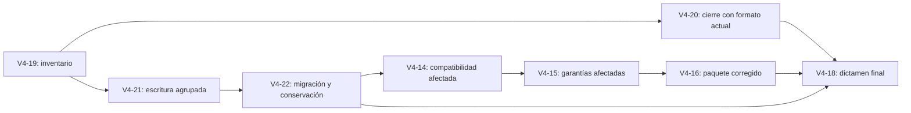

# Plan 4.0 — revisión 0.6 propuesta

Fecha: 2026-10-18. **Solo planificación; pendiente de validación y de autorización
de ejecución.** Incorpora cuatro tareas a la [revisión 0.5](REVISION-0.5.md),
sin implementar, migrar consumidores, ejecutar campañas, instalar ni publicar.
El registro estructurado es [REVISION-0.6.json](REVISION-0.6.json).
Fuentes: [reporte de cierre administrativo](<C:/Users/j.ormazabal/.codex/visualizations/2026/10/12/01a1320e-bd45-72e1-805e-db4a8ab7f8de/incidencia-lks-sdd-v4-cierre-administrativo.md>)
y [comparación congelada y ubicación de su evidencia](RESULTS-V4-17-SHARED-COMPARISON.md).

## 1. Prioridad, fundamento y límites

La prioridad es **desbloquear el cierre con el almacenamiento actual**, y después
reducir la fragmentación física. Compactar no será un requisito para cancelar,
reanudar o cerrar un proyecto que ya haya acumulado historia.

El reporte aportado cuenta 20.027 rutas Git, de las que 18.847 son internas y
1.180 están fuera de esas carpetas. El límite de 20.000 se aplica antes de las
exclusiones: la candidata 4.0 conserva ese defecto compartido. La cantidad externa
no equivale automáticamente a código elegible. Tampoco consta que todos los
archivos internos sean prescindibles o procedan de una sola implementación.

El censo del recorrido S8 ya ejecutado permite otra comparación: A añadió 448
archivos internos y B añadió 407, excluidos código de aplicación y despliegue del
runtime. B creó 389 objetos, muchos pequeños, con 1.367.937 bytes de objetos nuevos.
Los 656 archivos añadidos al preparar su runtime se contabilizan aparte: no son
archivos generados por cada implementación. Estas cifras son referencias de
diseño; no constituyen una medición de la solución que aquí se propone.

Se conservan M1 transporte/diagnóstico, M2 operaciones completas, M3 alcance
documental, M4 instrucciones por operación, M5 mantenimiento proporcional y
M6 cálculo medido. Las cuatro tareas son correcciones transversales, no una
séptima mejora. No cambian método 3.1.0, esquema canónico 3.1 ni autoridad humana.

La aceptación del usuario del resultado mixto de rendimiento se registra como
decisión de producto: conservar las mejoras observadas de transporte y llamadas
asumiendo el resultado temporal desfavorable. **AC-43 sigue no cumplido**; no se
reescribe el objetivo histórico del 20 %. AC-40 sigue inconcluso. Este acuerdo no
acepta el nuevo bloqueo de cierre ni exime de comprobar el almacenamiento nuevo.
Windows/H2 permanecen pendientes y fuera de este trabajo; se conserva la cobertura
local del plugin en Windows, incluidas rutas y temporales largos. Copilot y
valoración humana sostenida conservan su disposición anterior, sin marcarlos pasados.

## 2. Almacenamiento propuesto para 4.0

**Elegir paquetes inmutables de objetos técnicos dentro del repositorio**, con un
lector común que separe identidad lógica y ubicación física. El repositorio sigue
siendo portable y utilizable sin red. No se añade servicio externo, base de datos,
MCP, hook, skill ni proceso residente.

| Material | Ubicación y tratamiento propuestos |
|---|---|
| Especificaciones, prosa, decisiones, actores, autorizaciones y evidencias canónicas | Markdown actual en `docs/lks-sdd/`. Conservar registros distintos y enlaces; no fusionarlos por parecido ni reducir su contenido. |
| Objetos técnicos y cuerpos de recuperación que hoy son objetos SHA-256 | `.lks-sdd/store/packs/<SHA256>.pack`, con índice incorporado y bytes originales. Conservar referencias lógicas SHA-256/longitud. Un paquete agrupa las altas de una transacción, con partición por tamaño; nunca un paquete por fragmento. |
| Localización de objetos | `.lks-sdd/store/catalog.json`, versionado y protegido por la transacción; localiza objeto, paquete y rango. Es metadata técnica, no fuente de intención ni de permisos. El índice interno permite comprobar/reconstruir el catálogo; su reconstrucción es explícita. |
| Objetos grandes y proyectos anteriores | Lectura dual de objetos sueltos y empaquetados. Los objetos de más de 8 MiB pueden conservar el formato suelto existente, hasta su límite actual de 64 MiB. No se fragmentan para cumplir una cuota de archivos. |
| Historia por UID, manifiestos de estados y recibos | Se conservan sus identidades, formatos lógicos y registros Markdown. El lector de sus referencias usa el almacén común. Esta revisión no exige trasladar ni eliminar los Markdown históricos canónicos. |
| Capturas diagnósticas voluminosas | Captura externa explícita ya existente. Al conservar, importar los bytes necesarios una vez al almacén común, con procedencia y límites actuales. Traslado de carpeta o hash sin bytes no cuenta como conservación ni ahorro. |
| Exportación y recuperación | Bundle autocontenido con catálogo, paquetes y documentación necesaria; sin rutas absolutas del equipo ni dependencia del cache. Respaldo de migración fuera del árbol activo, identificado y medido por separado. |

Formatos físicos nuevos propuestos: `lks-sdd-object-pack/1` y
`lks-sdd-object-catalog/1`. Las referencias `lks-sdd-object/1` y los demás formatos
lógicos existentes conservan significado. El alcance modifica explícitamente la
decisión inicial de conservar solo las representaciones físicas existentes en
[CONTRACT.md](CONTRACT.md); requiere capacidades de lector declaradas en
distribución y runtime fijado, sin editar `specs/canonical/`.

Límites iniciales propuestos: objetivo de 8 MiB y máximo de 16 MiB por paquete,
índice interno de hasta 1 MiB/8.192 entradas y catálogo de hasta 16 MiB. Se parte el
paquete antes de alcanzar cualquiera de sus límites. Se mantienen los demás
límites de objeto, inventario, lectura y transacción; no se amplían implícitamente.
Un límite de recursos produce rechazo claro y sin aplicación parcial. No se promete
crecimiento ilimitado. Inicialmente, sin compresión, para acotar lectura y recuperación.

El escritor comprueba objetos existentes, prepara los paquetes necesarios y
publica catálogo y documentos mediante el protocolo transaccional recuperable.
El catálogo participa en las comprobaciones de frescura. Cada objeto leído debe
coincidir en longitud y hash; el paquete tiene identidad e integridad comprobables.
Los caches solo viven durante una evaluación y no sustituyen comprobaciones al
aplicar. Lectura por rango e índice evita expandir todo el historial para un objeto.
Objetos o ubicaciones contradictorios, rangos inválidos y corrupción se rechazan.
El diario/recibo debe permitir localizar los paquetes de recuperación aunque el
catálogo esté ausente o corrupto: no se hace depender su restauración del propio
catálogo dañado. Toda ampliación persistente del diario se versiona y declara
entre las capacidades, además de admitir los diarios anteriores. Se exige
publicación atómica por archivo y recuperación del conjunto, no atomicidad entre
varios archivos o entre el almacén y Git.

**Ventaja:** reduce archivos sin hacer depender el cierre de un servicio nuevo.
**Coste:** cambia el lector físico, exige migración y puede empeorar bytes Git o
latencia; ambos se medirán. Un archivo binario agregado no es ahorro por sí mismo.
Queda fuera de 4.0 un almacén externo compartido con servidor, autenticación,
disponibilidad y sincronización. La separación mediante el lector común facilita
evaluarlo después; mover miles de archivos sueltos fuera del repo no lo resolvería.

## 3. Cuatro tareas y dependencias

| ID / prioridad | Trabajo y entregable | Dependencias para cerrar | Aceptación |
|---|---|---|---|
| **V4-19 · P0 — Inventario sin falso exceso** | Corregir el inventario compartido; separar clasificación de rutas y límites de recursos; cubrir todos sus consumidores, no solo `close`. | V4-02A, V4-02B, en su alcance técnico ya disponible. | AC-45–47 |
| **V4-20 · P0 — Continuidad y cierre administrativo** | Probar la corrección con almacenamiento suelto y un runtime corregido; cancelación, sucesora, continuación y cierre nativos; entregar procedimiento de recuperación del caso real. | V4-19. **No depende de V4-21/22.** | AC-48–49 |
| **V4-21 · P1 — Menos archivos al escribir** | Introducir lector dual y escritor de paquetes; adaptar conservación diagnóstica, snapshots, objetos de uso y diarios; medir crecimiento y coste. | V4-19 y V4-04. Diseño físico de la sección 2 validado antes de codificar. | AC-50–52 |
| **V4-22 · P1 — Compactación recuperable y ciclo de vida** | Preparar migración explícita de objetos existentes, respaldo/restauración, compatibilidad de runtime, retirada autorizada de copias y política de conservación. | V4-21. | AC-53–56 |

Orden preferido, sin paralelismo de agentes obligatorio:

V4-18 conserva sus dependencias previas y añade V4-20/V4-22. V4-14 añade V4-22
para su ampliación de alcance; V4-15/V4-16 heredan esa dependencia. Sus resultados
anteriores siguen siendo evidencia del candidato anterior, pero no certifican el
almacenamiento nuevo. Solo se repiten controles afectados y el gate de distribución
exigible sobre la candidata exacta. No hay dependencia inversa que cree un ciclo.

### V4-19 — Detalle

1. Separar enumeración Git completa, normalización/deduplicación, clasificación
   segura y límite de código elegible. Excluir solo fronteras internas exactas y
   conservar exclusiones de secretos y otras reglas existentes antes de leer cuerpos.
2. Mantener 20.000 rutas elegibles; proponer cota independiente de 200.000 rutas
   brutas, 16 MiB de salida Git controlados durante captura y timeout de 60 s.
   Conservar límite de cuerpos de código y presupuesto de memoria. No capturar una
   salida sin límite para rechazarla después ni devolver inventarios truncados.
3. Contrastar inventarios previos válidos y consumidores de workflow, scope,
   presentación, preparación, frescura y almacenamiento. Corregir la prueba que
   confundía rutas excluidas con código elegible; mantener pruebas del límite bruto.
4. Fronteras obligatorias: 20.000/20.001 elegibles; 20.027 totales del reporte;
   límite bruto y de bytes; errores Git, ruta insegura, duplicados y modificación
   concurrente. Ni paginación ni cache permiten saltarse el último guard al aplicar.

### V4-20 — Detalle

1. Reconstruir un consumidor sintético con la forma del fallo, sin datos reales ni
   generar código artificial para llenar el inventario elegible.
2. Fijar runtime corregido mediante el mecanismo oficial recuperable; instalar un
   plugin global no demuestra que el consumidor haya cambiado de runtime.
3. Ejecutar el itinerario nativo autorizado del caso: cancelación administrativa,
   sucesora con alcance correcto, continuidad y cierre tras evidencias válidas.
   Reutilizar solo hechos/aprobaciones aún aplicables; cambios de sujeto, alcance o
   política obligan a reevaluar. No editar estados Markdown/JSON para forzar el cierre.
4. Entregar instrucciones de inspección, preflight, actualización compatible,
   preview, decisión aplicable, aplicación y recuperación. La ejecución en el
   proyecto real queda separada y requiere acceso y autorización específicos.

### V4-21 — Detalle

1. Fijar especificación física, capacidades y vectores de corrupción. Auditar usos
   que asumen `object_path` físico: staging, packets, journals, history, usage y
   exportaciones v2/v3. Ninguna capa puede saltarse el lector común.
2. Agrupar altas de objetos por transacción y reutilizar contenido existente entre
   paquetes. No crear un fichero por fragmento ni reempaquetar todo lo anterior en
   cada cambio. Conservar límites y semántica de las operaciones actuales.
3. Implementar lectura mixta, integridad, fijación de sujetos, publicación atómica
   por archivo y recuperación del conjunto. Conservar evidencia de fuentes
   retiradas y hashes de referencia.
4. Medir contra los mismos datos/eventos congelados; si los objetivos de AC-51/52
   no se cumplen, corregir el diseño o presentar bloqueo. No rebajar umbrales tras
   observar los resultados. No se activa el escritor nuevo en consumidores reales.

### V4-22 — Detalle

1. Inventariar referencias desde documentación, historia, estados, autorizaciones,
   packets, diarios pendientes/completados, migraciones y dependencias de runtime.
   Construir preview con elegibles, protegidos, espacio temporal y conflictos.
2. Crear respaldo independiente verificable y paquetes sin retirar originales;
   resolver todas las referencias y reconstruir estados/exports byte a byte.
   Una transacción pendiente o espacio insuficiente bloquea la migración con motivo.
3. Probar interrupciones al publicar paquete, catálogo, documentos y recibo; probar
   restauración completa. No deducir recuperación del éxito de una copia ni de doctor.
4. Retirar copias sueltas solo tras validación y **autorización de retirada
   independiente**, como exige DOCUMENT-STORAGE. En el sintético, prever esa
   autorización en el encargo de ensayo; en el proyecto real, presentar antes el preview.
5. Conservar todo contenido referenciado. Las consultas no compactan ni limpian.
   Recolección explícita: prueba de ausencia de referencias, preview y recuperación;
   referencias desconocidas o incidentes abiertos se conservan. Sin borrado por edad.
   No se cambian políticas de caches, instalaciones o worktrees del equipo.

## 4. Criterios nuevos: 12, todos pendientes

| ID | Propietario | Condición verificable de aceptación |
|---|---|---|
| AC-45 | V4-19 | El censo 20.027/18.847/1.180 no dispara el límite de código por rutas internas. Casos con 20.000 elegibles aceptan y 20.001 rechazan; inventarios completos e iguales a los previos en casos antes válidos. |
| AC-46 | V4-19 | Cotas brutas/de bytes/memoria/tiempo independientes y controladas durante enumeración; sin lectura de secretos, escapes, symlinks/junctions inseguros ni confusión de prefijos. Exceso/error no produce aplicación ni inventario parcial válido. |
| AC-47 | V4-19 | Todos los consumidores compartidos usan la misma clasificación; cambio de código, base, política o sujetos entre preparación y aplicación sigue rechazado con evidencia focal. |
| AC-48 | V4-20 | Itinerario sintético con historia acumulada y runtime corregido completa cancelación, sucesora y cierre nativos usando almacenamiento anterior, sin bypass ni journal pendiente. Se conserva trazabilidad del original y de la sucesora. |
| AC-49 | V4-20 | Autorización/evidencia obsoletas no se reutilizan; fallo o interrupción conserva/restaura el estado válido sin pérdida ni transición parcial. Runbook distingue corrección técnica y resolución aún no ejecutada en el consumidor real. |
| AC-50 | V4-21 | Lectura dual devuelve los mismos bytes/hashes; registros Markdown canónicos conservados; objetos antiguos y nuevos, historia, packets y recuperación se resuelven por lector común. Capacidades físicas versionadas y contradicciones rechazadas. |
| AC-51 | V4-21 | Mismo recorrido/datos B: **al menos 80 % menos archivos internos nuevos**, de 407 a **81 como máximo**, contando paquetes, catálogo, índices, manifiestos y recibos. Runtime y aplicación se muestran aparte, sin retirar entradas iniciales ni desplazar el coste a otra carpeta. Bytes nuevos persistidos no superan en más del 10 % la misma referencia completa. |
| AC-52 | V4-21 | Consultas: cero escrituras. Repetición idempotente: sin nuevas copias físicas del mismo objeto. CPU mediana del componente comparable ≤1,10× referencia; pico ≤512 MiB y ≤1,10× referencia. Todos los costes de catálogo, integridad y conservación están incluidos; tiempo observado también se informa. |
| AC-53 | V4-22 | Compactación sintética de histórico representativo: **al menos 50 % menos archivos internos totales**, con runtime y Markdown canónico conservados; todas las referencias/bytes originales recuperables. Se informa también reducción específica del almacén, bytes y espacio de Git. No se declara ahorro físico mientras sigan las copias sueltas activas. |
| AC-54 | V4-22 | Cada frontera de interrupción/corrupción de paquete, índice o catálogo deja estado anterior válido o recuperación determinista. El diario permite recuperar sin el catálogo afectado; formatos anteriores siguen admitidos. Restauración desde respaldo independiente verificada; concurrencia y diario pendiente no permiten pérdida, doble aplicación ni limpieza prematura. |
| AC-55 | V4-22 | Preview separa contenido referenciado, desconocido y elegible; retirada requiere autorización independiente y recuperación. Cero eliminación automática al consultar; comprobación previa de espacio. Bytes y archivos de backups, exportaciones y temporales se informan, no se esconden como ahorro global. |
| AC-56 | V4-22 + V4-14/15/16 | Runtime/distribución declaran los formatos nuevos; actualización y exportación portables verificadas. Antes de convertir se comprueba el lector compatible. Tras nuevas escrituras, volver al runtime antiguo exige restauración o exportación inversa compatible; no solo cambiar el pin. Paquete exacto y controles afectados pasan, sin atribuir capacidades nuevas a 3.4.3 ni ejecutar instalación/publicación. |

Las 44 condiciones anteriores se conservan con sus resultados y límites: total
**27 tareas / 56 criterios**, sin convertir pendientes o fallos históricos en éxitos.
El desbloqueo P0 exige AC-45–49. La corrección de volumen exige AC-50–56; no se
considera terminada solo por resolver el umbral de inventario.

## 5. Comprobación del ahorro y de las garantías

1. Congelar entradas y secuencia de eventos del B ya ejecutado. Comparar escritor
   anterior/nuevo con igual contenido lógico, decisiones y evidencia; no una versión
   con menos operaciones o menos documentación. Registrar huellas de ambas fuentes.
2. Censar todas las rutas internas iniciales/finales, añadidas y retiradas, incluidas
   ignoradas/no versionadas. Separar CAS, historia, Markdown, evidencia, runtime,
   temporales y exportaciones; no sumar dos veces subcategorías. El umbral 81 se
   aplica al crecimiento **bruto de altas**, sin compensarlo borrando archivos viejos.
3. Conservar el control Git de la incidencia y medir además bytes lógicos, bytes
   asignados, bytes totales conservados y tamaño del repositorio/artefacto portable.
   Una caída de archivos no prueba reducción de bytes ni del historial Git anterior;
   no se reescribe Git. Backups externos no desaparecen del balance total de disco.
4. Para costes del componente: una preparación y tres muestras por representación,
   alternando orden, con mismo trabajo y límites. Automatizar esperas; sin polling
   del agente, perfilado recurrente ni repetir hasta pasar. Informar dispersión y
   CPU/tiempo/memoria; la variabilidad del equipo no elimina muestras desfavorables.
5. Comprobar igualdad de contenido, todos los enlaces/estados de la migración,
   autoridad, frescura, rechazo de corrupción y restauración. Fallar cualquiera
   invalida el ahorro. Coste del host/modelo y `billed_tokens` siguen no observados;
   no estimarlos desde caracteres, llamadas ni duración de Python.

Validación futura mínima: pruebas focales del inventario y almacén, pruebas de
fronteras de recuperación, y **dos recorridos completos adicionales propuestos**:
(1) continuidad administrativa con formato anterior; (2) migración/compactación y
recorrido funcional S8 con lector nuevo y recuperación. Las inyecciones negativas
se prueban a nivel de componente, sin repetir todo S8 por cada fallo. Un replay
aislado del escritor no se presenta como un recorrido completo ni como evidencia
de ahorro temporal de toda la tarea. Gate estable del repositorio según
[docs/VALIDATION.md](../../VALIDATION.md) al consolidar los cambios; controles
intermedios solo cuando los justifique la superficie modificada.

## 6. Presupuesto, puntos de corte y decisiones

El último registro tiene **54/54 plazas conocidas/reservadas**, incluidas las dos
de H2 protegidas. La última ampliación ABBA consumió cuatro; sus 45 minutos no se
reabren. El máximo histórico autorizado es 15 h (12 + 3), sin saldo actual positivo
certificado para esta ampliación. Este documento **no amplía ni reutiliza esas bolsas**.

Estimación inicial, no compromiso ni autorización: V4-19, 1–2 h; V4-20, 0,5–1 h;
V4-21, 4–8 h; V4-22, 2–4 h; consolidación afectada V4-14/15/16/18, 1–2 h:
**8,5–17 h de entorno, más reserva propuesta del 20 %: 10,2–20,4 h**.
Incluye implementación, corrección, validación automática y consolidación; las
esperas técnicas consumen esa cota. No equivale a atención humana ni a tiempo
continuo de llamadas de IA. Es de baja confianza hasta revisar el prototipo del lector.
No se promete que quepa en el presupuesto agotado ni se autoriza todo el rango.

Propuesta de ejecución por etapas, para decidir antes de comprometer el bloque caro:

- **Hito A:** V4-19/20, 1,5–3 h orientativas y un recorrido adicional reservado.
  Presentar cierre sintético y procedimiento real antes del almacén nuevo.
- **Hito B:** primer prototipo de V4-21, dentro de sus 4–8 h, con lectura dual y
  replay de crecimiento. Continuar solo si no hay contradicción contractual y los
  objetivos de archivos/coste resultan viables; si no, presentar diseño revisado.
- **Hito C:** completar V4-21/22 y consolidación, con el segundo recorrido reservado.
  Cada recorrido tiene corte de 600 s; fallos consumen su plaza. No hay repeticiones
  completas automáticas. Se detiene antes del corte de presupuesto para recuperar.

Antes de ejecutar deben acordarse cota adicional de horas, dos plazas nuevas
(llevarían el total a 56, sin consumir H2) y reserva de recuperación dentro de la
cota. La implementación puede autorizarse por hito; no exige aprobar de golpe todo
el rango. Toda demora o ampliación se comunica antes de agotar el bloque autorizado.

Decisiones propuestas para validar: almacenamiento empaquetado local, objetivos
80 % de crecimiento / 50 % de histórico representativo, límites de recursos y
ampliación física versionada. La fecha de retirada de backups reales se fija en el
preview operativo según dependencias/incidencias; no se inventa una caducidad para
la historia canónica. La reparación del consumidor real, instalación, publicación,
commits y push siguen siendo actuaciones distintas y no autorizadas por este plan.
