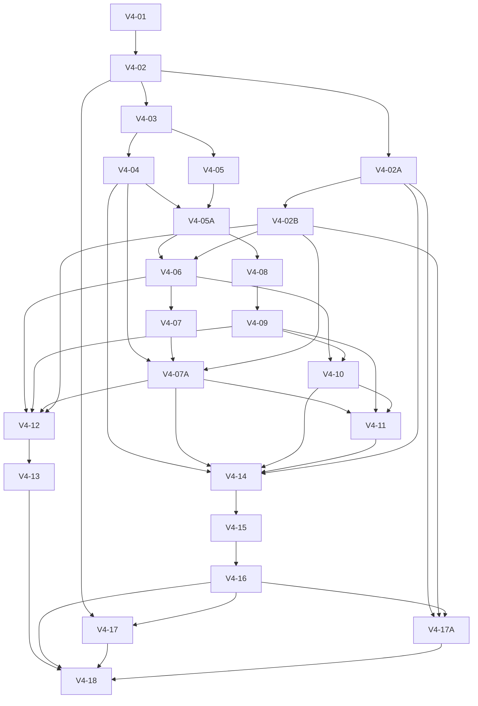

**Decisión vigente:** el responsable valida y cierra el desarrollo, autoriza publicar 4.0.0 y distribuirla en Codex. Se mantienen las reservas de Windows/H2 y medición; los controles técnicos pendientes no se convierten en superados. Aprobación: [4.0.0](../../../quality/release-approval-v4.0.0.json); [actualización y límites](../../UPGRADE-4.0.0.md). Publicación efectiva y gate se acreditan por separado.

**Estado vigente de 0.7 validada:** V4-15 técnica, V4-16 y V4-18 cerradas con reservas explícitas; [resultado final](RESULTS-V4-19-20.md#v4-15-v4-16-y-v4-18--cierre-técnico-y-paquetes-finales-de-desarrollo). Desarrollo y paquetes preparados; aceptación completa, aprobación de versión e integración/gate estable separados. Windows/H2 pendientes; sin instalación ni publicación. Seis mejoras y presupuestos conservados.

**Resultado técnico anterior:** nueva serie ABBA completa: salida −26,7 %, flujo medido −44,9 %, llamadas −25 % y memoria válida; tiempo técnico +33,5 %, objetivo S8 no cumplido ([resultado](RESULTS-V4-17-SHARED-COMPARISON.md)). 54/54 plazas conocidas/reservadas, H2 protegida; Windows/H2 pendientes.
# LKS-SDD 4.0 — Tareas y dependencias

**Antecedente — cierre operativo:** [perfiles retirados y residual conservado](RESULTS-H2-OPERATIONAL-CLOSURE.md). La incidencia de Windows sigue abierta; H2/AC-34 inconclusos, sin nuevas pruebas, cargas o accesos.

**Antecedente — revisión de recuperación:** [incumplimiento de cota, recuperación y saldo recalculado](REVIEW-H2-MINIMAL-RECOVERY.md). El ensayo mínimo cerró en 358,500 s; H2 sigue inconcluso y no es admisible con el saldo actual. Recuperación operativa propuesta; estado nativo y retirada física pendientes.

**Antecedente — ejecución H2:** [ejecución H2 0.2: corte P2, perfiles recuperados y cero casos](RESULTS-H2-02.md). AC-34 pendiente; no se inicia V4-06. Los estados anteriores se conservan como antecedentes.

**Antecedente operativo (2026-10-16):** [carga A/B resuelta; aislamiento sin acreditar; recuperación de perfiles comprobada](RESULTS-H2-CONTINUATION.md). Ningún caso H2 iniciado, AC-34 pendiente. Se conserva estado nativo de Windows sin acreditar su reversión; no hay candidata activa. Los estados preparatorios e informes anteriores que siguen se conservan como antecedentes.

Plan: [revisión 0.4](PLAN.md). Actualización: 2026-10-16.
Estado: **plan 0.4 validado; V4-02A/B preparatorias y V4-03/04/05 técnicas verificadas;
V4-05A autorizada, con porción técnica verificada y AC-34 pendiente de pareja real H2**.
El cierre H1 original está en RESULTS-H1.md; el actual de V4-02A/B en
[RESULTS-V4-02AB.md](RESULTS-V4-02AB.md).
Autorizar estas tareas preparatorias no autoriza modificaciones del plugin.
Actualización de V4-02: Codex primero, Copilot al final y presupuestos aceptados.
Continuación vigente: carga aislada A/B autorizada y verificada, después revertida.
La pareja real sigue `not-run` por aislamiento nativo sin acreditar.
[Resultado y recuperación por alcance](RESULTS-H2-CONTINUATION.md). No hay
autorización para tareas posteriores ni nueva reserva de tiempo.
P01 participó en S1/S2, cerrados técnicamente. La [revisión crítica](REVIEW-S1-S2.md)
consolida evidencias y tokens; atención activa no cronometrada, según P01.
[Decisión posterior](DECISION-TECHNICAL-SCOPE.md): valoración humana en uso real
sostenido; repetición cronometrada retirada sin ejecutar. **AC-33/V4-02 cerrados en
alcance técnico Codex**, con [protocolo 1.0](MEASUREMENT-PROTOCOL.md), antes de la
implementación local autorizada posteriormente. Estado actual de V4-05A en su ficha.
R1 → V4-02A; R2 → V4-17A; R3 → V4-02B; R4 → V4-07A. Las cuatro tareas se registraron
inicialmente `planned`; V4-02A/B pasan a `verified` en alcance preparatorio con incertidumbres explícitas.
[Resultados](RESULTS-V4-02AB.md) y [contrato S8 del 20 %](S8-PROTOCOL.md).
La [revisión crítica](REVIEW-0.3.md) mantiene 23 tareas y 44 AC: sin ciclos,
43 plazas conocidas/reservadas y viabilidad integral de horas no acreditada.

Las dependencias de la tabla son entregables técnicos verificados necesarios para
cerrar la tarea, salvo V4-05A, que exige además su observación temprana propia.
Ninguna tarea anterior a V4-17 exige la aceptación final de V4-17/V4-17A para cerrar.
Se puede diseñar o preparar fixtures con un contrato de dependencia ya fijado; no
se declara integración terminada sin su productor. V4-02 se cierra con referencia,
viabilidad de medición y protocolo; no exige una candidata. La autorización futura
precede a toda implementación. Los roles son funciones, no personas asignadas.

## 1. Resumen ejecutable tras autorización

| ID | Entregable | Dependencias directas para cerrar | Rol principal | Mejora |
|---|---|---|---|---|
| V4-01 | Contrato mínimo, fronteras, invariantes y decisión de compatibilidad | Ninguna | Contrato/núcleo | Todas |
| V4-02 | Referencia 3.4.3, viabilidad de medición, alcance y presupuesto congelados | V4-01 | Medición/revisión/producto | Todas |
| V4-02A | Versión efectiva, caso migrado representativo y disposición del incidente en 3.4.3 | V4-02 | Medición/núcleo | M6, transversal |
| V4-02B | Criterio temporal S8, límites de ensayo y política de coste residual congelados | V4-02A | Medición/producto | M6, M1, M2 |
| V4-03 | Presentación mínima con acceso íntegro compatible | V4-02 | CLI/presentación | M1 |
| V4-04 | Captura y conservación diagnóstica sin copiado por el agente | V4-03 | Diagnóstico/almacenamiento | M1 |
| V4-05 | Consulta compuesta para preparar trabajo | V4-03 | Núcleo/recorrido | M2 |
| V4-05A | Primer recorrido completo, instrucciones, paquete provisional y utilidad observada | V4-04, V4-05 | Experiencia/hosts/distribución | M1, M2, M4 |
| V4-06 | Inicio/reanudación y registro compuesto de resultados; pareja S8 temprana | V4-05A técnica (H2 pendiente), V4-02B | Núcleo/transacciones | M2 |
| V4-07 | Continuidad reconstruible y paradas comprensibles | V4-06 | Recorrido/experiencia | M2 |
| V4-07A | Actividad observable, interrupción y recuperación seguras | V4-04, V4-07, V4-02B | CLI/transacciones/experiencia | M1, M2 |
| V4-08 | Autoría de alcance y ensayo acotado de legado | V4-05A técnica (H2 pendiente) | Contexto/autoría | M3 |
| V4-09 | Selector completo por aplicabilidad, comparación y diagnóstico | V4-08 | Contexto/revisión | M3 |
| V4-10 | Aportación demostrada a tres recorridos existentes de mantenimiento | V4-06, V4-09 | Contrato/correcciones | M5 |
| V4-11 | Seis skills e instrucciones por operación | V4-07A, V4-09, V4-10 | Experiencia/hosts | M4 |
| V4-12 | Perfil de coste y oportunidades reproducidas | V4-06, V4-09, V4-07A, V4-02B | Rendimiento | M6 |
| V4-13 | Optimizaciones aceptadas o descarte motivado | V4-12 | Núcleo/revisión | M6 |
| V4-14 | Compatibilidad y actualización recuperable | V4-04, V4-07A, V4-10, V4-11, V4-02A | Distribución/migración | Transversal |
| V4-15 | Verificación integrada de garantías | V4-14 | Revisión técnica | Todas |
| V4-16 | Paquetes de desarrollo y guía de actualización | V4-15 | Distribución | Todas |
| V4-17 | Comparación completa y observación real por host | V4-02, V4-16 | Medición/producto | Todas |
| V4-17A | Regresión y latencia del recorrido de entrega migrado S8 sobre paquete final | V4-02A, V4-02B, V4-16 | Medición/revisión | M2, M6, transversal |
| V4-18 | Informe de aceptación, límites y preparación de release | V4-13, V4-16, V4-17, V4-17A | Producto/mantenimiento | Todas |

Cada tarea entrega regresiones focales; V4-15 consolida. V4-05A produce su propio
paquete provisional y prueba de uso antes de ampliar capacidades; no depende de
V4-11/V4-16/V4-17. V4-17 prepara observación desde V4-02, pero la aceptación final
corresponde al candidato exacto de V4-16. Un ensayo temprano no se cuenta como
aceptación final si cambia el comportamiento, instrucciones o paquete relevante.
V4-13 tiene corte y presupuesto: no retrasa el primer recorrido ni construir V4-16.
Toda variante incorporada necesita verificación y paquete actualizados; una variante
fuera del corte se descarta de esta versión. V4-18 exige su disposición, no una
optimización obligatoria. No hay calendario sin capacidad y duraciones acordadas.
V4-02A/V4-02B añaden preparación sin reabrir V4-02 ni bloquear M1/H2 independiente.
La reserva incluye 2 intentos S8 tempranos, 4 finales AB/BA y 4 plazas protegidas
para incidencias: con 7 cargos conocidos, 2 H2 y 24 finales, suma 43/48.
Los componentes y regresiones focales consumen horas; si completan una tarea,
también consumen intento. No se reclasifican para ocultar coste. M6 adicional de
12 intentos no cabe en este compromiso; cotas y límites en ADDENDUM-PERFORMANCE.md.
Windows se verifica en las tareas existentes, sin una quinta tarea del reporte.

## 2. Fichas de trabajo

### V4-01 — Contrato mínimo y compatibilidad

- **Entregable:** entradas/salidas, errores, vigencia, efectos, recuperación y ejemplos
  positivos/negativos de cada operación; matriz G1–G10 y reglas asignadas a componentes.
- **Ámbito:** documentación propuesta y fronteras de `v3_cli`, `v3_current`,
  `v3_storage`, `v3_presentation_guard`, `v3_schema`, distribución y observación.
- **Decisión:** conservar método 3.1.0/schema 3.1 solo si se demuestra compatibilidad;
  declarar nombres/versiones de formatos técnicos y capacidad requerida del runtime.
  Identificar cambios que necesitan decisión material antes de implementarlos.
- **Aceptación:** AC-01, AC-02, AC-03. Ninguna operación nueva puede autorizar por
  defecto, confundir consulta/captura o depender de memoria supuesta del host.
- **Evidencia:** contrato revisado y mapa de invariantes; no registrar aprobación
  humana por el mero hecho de completar esta ficha.

### V4-02 — Referencia, medición viable y presupuesto antes de tocar producto

- **Entregable:** fuentes/bundles 3.4.3 fijados por SHA, escenarios S1–S7, referencia
  y protocolo de [VALIDATION.md](VALIDATION.md); matriz de métricas por host con una
  prueba corta real, responsable, límites de cobertura y fuente recuperable.
- **Ámbito:** herramientas de medición existentes en `tests/measure_*`, fixtures y
  evidencia externa al runtime. Reutilizar y ampliar lo necesario; no crear una
  plataforma de telemetría ni una nueva puerta recurrente de release.
- **Método:** baseline con carga selectiva, modo compacto y decisiones reutilizadas
  correctamente; documentar aparte el uso real defectuoso si se aporta evidencia.
- **Aceptación:** AC-33, sin exigir candidata ni AC-27/AC-28 finales. Fijar medición
  de transporte completo y coordinación del agente; confirmar métricas de tokens disponibles,
  umbrales y alcance de las afirmaciones. Si faltan, decidir expresamente cómo limitar
  la demostración o resolver su acceso antes de ampliar el desarrollo.
- **Presupuesto:** registrar máximos numéricos de ejecuciones, horas de persona y
  entorno, coste observable y estudio M6; responsables, corte, ampliación y parada.
  Los techos 48 ejecuciones/8 h persona/12 h entorno y M6 dos variantes/cuatro horas
  ya están aceptados; parámetros técnicos fijados en MEASUREMENT-PROTOCOL.md. La decisión
  DECISION-TECHNICAL-SCOPE.md difiere E5/AC-36 y `delta_admin` a uso real sostenido.
- **Casos de mantenimiento:** recoger recorridos actuales bien usados y fricción
  observada para la comparación antes/después de V4-10; no atribuir al núcleo un
  problema de instrucciones sin evidencia.
- **Pendiente externo:** probar acceso a hosts y prever carga autorizada de la
  candidata. Si un host no está disponible, registrar el límite y decidir el alcance
  antes de cerrar. La referencia técnica puede prepararse, pero no sustituye AC-33.
  El alcance ya está decidido: Codex inicial y Copilot aplazado al final. La extracción
  numérica por turno Codex se ha contrastado en la calibración y los turnos cerrados
  de S1/S2. Ambos casos están ejecutados técnicamente; ventanas comparables y
  parámetros técnicos fijados en protocolo 1.0. Por decisión del usuario no se exige referencia humana
  cronometrada ni `delta_admin` para este cierre. Se conservan los tiempos históricos
  no medidos. DECISION-TECHNICAL-SCOPE.md fija el alcance; no se reabre host/presupuesto.

### V4-02A — Versión efectiva y aprobaciones heredadas (R1)

- **Dependencia:** V4-02; ejecución autorizada al validar 0.4. Estado: `verified`
  preparatorio; AC-37/38 superados, resolución del incidente real inconclusa. Ver RESULTS-V4-02AB.md.
- **Entregable:** fixture S8 versionado e inventario esperado independiente; ficha
  de correspondencia y versiones/digests instalados, fijados y ejecutados.
- **Trabajo:** máximo dos tamaños, mínimo causal y objetivo con 35 tecnologías;
  decisiones heredadas/posteriores, globales, prosa incierta y dependencias. Reutilizar
  generadores, sin datos reales ni reproducción exacta inferida por número de elementos.
- **Método:** hasta cuatro invocaciones frías (dos tamaños × 3.4.2/3.4.3), corte de
  120 s por componente y perfil opcional separado de hasta 30 s. Todo dentro de
  45 min, incluida preparación/informe. Son cortes de estudio, no SLA ni resultados.
- **Aceptación:** AC-37/AC-38. Diagnóstico resuelto en caso representado, persiste o
  inconcluso; este último permite cerrar investigación solo con fixture válido y
  representatividad acreditada. Fixture inválido deja AC-38 pendiente y la tarea
  sin verificar. Timeout conserva coste/cota temporal, nunca resolución del incidente.
- **Evidencia:** fuentes, hashes, inventario, resultados/errores y costes; no atribuir
  a 4.0 lo que mejoró 3.4.2→3.4.3. Reutilizar S8 en V4-06/12/15/17A.
- **Windows:** registrar raíces y longitud máxima de rutas creadas; evitar copias
  recursivas de temporales. La variante deliberadamente larga se asigna a V4-14/15,
  sin multiplicar la matriz de rendimiento por longitudes de ruta.

### V4-02B — Latencia operativa y coste residual (R3)

- **Dependencia:** V4-02A. Condiciona S8, V4-07A y optimización que use ese caso;
  no V4-03 ni H2 independiente. Umbrales H2/protocolo 1.0 congelados sin cambios.
- **Entregable:** registro numérico de aceptación temporal por hito/recorrido,
  memoria, actividad/interrupción, sobrecoste y corte por intento (máximo 600 s).
  Decisión posterior: mejora temporal completa S8 ≥20 % frente a 3.4.3; sin máximo
  absoluto adicional. Contrato especificado en S8-PROTOCOL; AC-39 verificado en alcance
  preparatorio tras muestra pública aislada; medición final de producto pendiente.
- **Trabajo:** fijar valores antes de medir S8 candidato o diseñar su optimización/
  actividad. Distinguir necesidad operativa, observación y corte experimental.
  Mapear comandos A/B a los mismos efectos/condiciones, sin exigir igual número.
- **Aceptación:** AC-39. Ningún campo crítico vacío; unidades, justificación,
  responsable, entorno, raíces Windows, ventanas y reglas de fallo definidos.
  La referencia y la mejora relativa deben poder comprobarse dentro del corte y
  reserva disponibles; fase y recorrido conservan sus tiempos sin SLA absoluto adicional.
- **Cota:** 15 min de entorno; si falta una decisión o capacidad, queda pendiente
  el alcance dependiente. No pedir cronometraje humano ni inventar SLA del ZIP.
- **Disposición:** diagnóstico y fijación de criterios no esperan a AC-43 futuro.
  Un bloqueo confirmado no se resuelve descartando M6 ni reduciendo el umbral.

### V4-03 — Presentación mínima y transporte compatible

- **Seguimiento actual:** `verified` en alcance técnico local; AC-04/AC-05 superados; ver
  [resultados](RESULTS-V4-03.md) y [registro actual](v4-03-progress.json).
  La [revisión crítica correctiva](REVIEW-V4-03.md) sustituye el dictamen y ahorro
  iniciales sin cambiar dependencias ni criterios.
- **Entregable:** representación de resultados sin duplicación accidental; detalle
  íntegro recuperable, estados/errores coherentes y modo anterior compatible.
- **Ámbito:** `v3_cli`, `v3_decision_presentation`, `query_render` si resulta aplicable;
  pruebas de presentación y de todas las combinaciones de opciones soportadas.
- **Casos:** consulta, decisión, preview, aplicación, bloqueo y recuperación; `--json`,
  compactación, detalle y exportación con semántica consistente. No basta mejorar una
  vista mientras otra combinación vuelve a volcar todo el resultado.
- **Aceptación:** AC-04, AC-05. Misma decisión y recibo para el mismo contenido;
  advertencias y obligaciones necesarias siguen visibles. Un archivo exportado
  no acredita su lectura ni autoriza algo que aún no se ha presentado.
- **Evidencia:** comparación de cuerpos, recibos, impedimentos y bytes totales de CLI.

### V4-04 — Diagnóstico programático y conservación

- **Seguimiento actual:** `verified` en alcance técnico local; AC-06/07/08 superados en cobertura focal;
  [resultados](RESULTS-V4-04.md) y [registro actual](v4-04-progress.json).
  No autoriza iniciar V4-05 ni publicar/instalar el candidato.
  La [revisión crítica correctiva](REVIEW-V4-04.md) concreta el dictamen vigente y
  conserva los resultados iniciales como históricos, sin ampliar presupuestos.
- **Entregable:** captura referenciada y lotes conservados en hitos autorizados sin
  reconstruirlos con el modelo; resumen y exportación autónoma siguen disponibles.
- **Ámbito:** `v3_usage`, `usage_report`, `usage_bundle`, `content_store`, integración
  con el journal y formatos técnicos definidos en V4-01.
- **Casos:** origen válido/inválido, fuente modificada o retirada, reenvío idéntico,
  colisión, interrupción, material ausente, tamaño excesivo y captura deshabilitada.
- **Aceptación:** AC-06, AC-07, AC-08. Destino/retención explícitos, sin contaminación
  normativa ni cambios en autoridad; no degradar corrupción canónica a un aviso.
  Datos importados conservan su procedencia, sin promover una declaración a medición.
- **Evidencia:** paquete investigable fuera del chat original, contabilidad íntegra
  del transporte y coste separado de capturar/conservar/reportar/exportar.
- **Windows:** reutilizar helpers de rutas y escritura existentes; nombres acotados,
  destinos explícitos y limpieza limitada al área propia. Incluir temporales largos
  y ausencia de crecimiento por reintento en la cobertura consolidada V4-14/15.

### V4-05 — Preparar trabajo en una consulta

- **Estado:** `verified` en alcance técnico local; [corrección Git/Windows](RESULTS-V4-05-GIT-WINDOWS.md)
  y condiciones de compatibilidad verificadas. [Entrega inicial](RESULTS-V4-05.md) y
  [estado actual](v4-05-progress.json). No inicia V4-05A ni autoriza publicación.
  La [revisión correctiva](REVIEW-V4-05.md) conserva el histórico y delimita
  las pruebas repetidas sobre la candidata revisada.
- **Corrección Git/Windows:** recorrido público >260 caracteres verificado bajo
  sus condiciones explícitas, sin configuración global ni mutaciones del consumidor.
  Se conservan identidad, contrato y equivalencia de condiciones; la regresión queda
  disponible para V4-15. Esto no acredita soporte universal ni inicia V4-05A.

- **Entregable:** consulta compuesta de estado, intervenciones, preparación y contexto
  literal, con causa mínima y porción independiente que puede continuar.
- **Ámbito:** `v3_guidance`, `v31_guidance`, `v3_context`, `v3_workflow`, CLI común.
- **Casos:** tarea autorizada, autorización ausente, raíz ambigua/retirada, independencia
  parcial, política distinta, runtime no apto y cambio de base durante la preparación.
- **Aceptación:** AC-09, AC-10. Equivalencia de condiciones con las consultas individuales;
  base coherente, cero mutaciones y ningún resultado `ready` vacío por omisión.
- **Evidencia:** comparación diferencial y recorrido público desde cada adaptador.
- **Ampliación 0.3:**
  Incluir preparación S8 con obligaciones completas y contadores de evaluación;
  su aceptación final permanece en V4-17A.

### V4-05A — Primer recorrido completo y utilidad temprana

- **Estado actual:** `in-progress`, con porción técnica verificada: S1 final 36/36,
  14 regresiones distintas y siete artefactos reproducibles. AC-34 sigue pendiente
  de la pareja real H2; no se acredita ahorro por el ensayo del CLI. La autorización
  de este bloque no incluye registro/instalación/activación en el host.
  [Resultados](RESULTS-V4-05A.md), [continuación H2](V4-05A-HOST-HANDOFF.md) y
  [seguimiento](v4-05a-progress.json). Dos intentos completos adicionales contabilizados;
  presupuestos y reservas H2/finales conservados, saldo histórico no certificado.

- **Entregable:** una corrección cubierta S1 de principio a fin con M1, preparación
  M2 e instrucciones M4; usa operaciones individuales vigentes para ejecutar,
  comprobar y registrar lo que aún no está agrupado. Adapta solo las rutas necesarias
  de las seis skills, sin crear otras. Incluye un paquete provisional reproducible.
- **Ámbito:** integración de V4-03/V4-04/V4-05, instrucciones por operación y builders
  existentes. No espera a la adaptación completa V4-11 ni al paquete final V4-16.
- **Aceptación:** AC-34. Una pareja referencia/candidata en al menos un host previsto
  en V4-02, con participante real, tarea completa, garantías y evidencia técnica de
  la porción. Registrar lecturas, llamadas, calidad y consumo técnico disponible;
  percepción/esfuerzo humano siguen diferidos por la decisión vigente.
  Debe observarse beneficio en la métrica temprana fijada en V4-02 sin nueva fricción;
  si no se demuestra, corregir esta porción antes de ampliar M3/M5/M6.
- **Evidencia:** hashes, instrucciones utilizadas, resultado funcional, captura y
  límites. El ensayo pertenece al presupuesto total; no prueba los objetivos finales
  ni ambos hosts. Si cargar el paquete requiere permiso no existente, queda pendiente,
  no se simula uso real. No necesita evidencia futura de V4-17 para cerrar.

### V4-06 — Transiciones y resultados agrupados

- **Estado vigente 0.5:** implementada; AC-11/12/13 verificados técnicamente y regresión de rendimiento abierta. Depende de la porción
  técnica verificada de V4-05A y de V4-02B. H2/AC-34 sigue pendiente y la incidencia
  de aislamiento queda apartada. [Resultado](RESULTS-V4-06.md). Continuación solicitada; no hay financiación acreditada para completarla.
- **Cota vigente:** bloque completo de 145 min bajo el máximo acumulado de 15 h,
  con errores, pareja S8 y cierre incluidos; [reasignación](REVISION-0.5.md).
- **Entregable:** inicio/reanudación y registro compuesto de resultados acreditados,
  con eventos separados, idempotencia y recuperación explícitas.
- **Ámbito:** `v3_workflow`, `v3_verification`, `v3_storage`, `v3_presentation_guard`,
  CLI y mecanismos vigentes de evidencia/calidad/asignación.
- **Casos:** permiso válido/revocado, respuesta parcial, recepción por destinatario,
  prueba fallida o antigua, reintento, modificación concurrente y fallo intermedio.
- **Aceptación:** AC-11, AC-12, AC-13. Cada etapa satisface sus condiciones sobre el
  estado correcto. La agrupación no cruza aceptación funcional, nueva autorización,
  revisión independiente pendiente ni publicación. Registro no significa ejecutar pruebas.
- **Evidencia:** equivalencia de efectos/errores frente al recorrido individual;
  recuperación y ausencia de doble efecto. No afirmar atomicidad de acciones externas.
- **Ampliación 0.3:**
  Añadir las fases S8 afectadas y sus evaluaciones internas; conservar la ruta
  individual y las guardas frescas antes de preparar/aplicar.
- **Revisión 0.4:** tras V4-02B, ejecutar una pareja completa S8 temprana AB (dos
  intentos reservados) sobre referencia/prototipo con implementación y prueba reales.
  Detecta defectos antes del paquete final; no sustituye AC-42/43 ni exige que
  V4-07A ya exista. Registrar qué capacidades aún no están implementadas.

### V4-07 — Reanudar con continuidad segura

**Actualización V4-07:** vista de continuidad implementada y verificada técnicamente; [evidencia y límites](RESULTS-V4-06-07.md). H2 y observación real S6 siguen pendientes.

- **Entregable:** vista derivada de tarea, estado, decisiones, pendientes y fuentes;
  instrucciones comprensibles de siguiente acción y lectura necesaria.
- **Ámbito:** `v3_guidance`, `v31_guidance`, `v3_context` y guías de continuidad.
- **Casos:** conversación nueva, compactación, cambio de operador, runtime, contrato,
  rama o evidencia; trabajo independiente abierto y relevo recibido/no recibido.
- **Aceptación:** AC-14. Se conserva estado útil sin depender del chat anterior;
  se recupera contrato literal aplicable cuando haga falta y no se hereda identidad.
  La vista no crea otra fuente canónica ni exige checkpoints por consultar.
- **Evidencia de cierre técnico:** pruebas de continuidad AC-14. La observación real
  de reanudación S6 pertenece a AC-30/V4-17 y queda pendiente sin impedir este cierre.

### V4-07A — Actividad observable e interrupción segura (R4)

**Seguimiento actual:** implementada localmente; validación y límites en
[RESULTS-V4-07A.md](RESULTS-V4-07A.md). AC-40 pendiente de acreditar el sobrecoste;
no se declara cerrada la tarea ni sus dependencias de cierre. Windows y H2 pendientes.

- **Dependencias:** V4-04, V4-07 y V4-02B.
- **Entregable:** canal optativo de fase/actividad y recuperación con mecanismos
  existentes; contrato previo coherente con CONTRACT.md, sin servicio ni motor nuevo.
- **Ámbito:** puntos cooperativos de fase/cálculo, CLI y journal existentes. Declarar
  por fase límites de E/S no interrumpible; no prometer aborto instantáneo ni cero
  artefactos técnicos. Separar contrato, captura externa, objetos y journal.
- **Aceptación:** AC-40/AC-41. Cadencia, volumen, reacción y sobrecoste cumplen
  parámetros en fases/superficies declaradas y probadas. JSON final íntegro,
  efectos parciales explícitos, recuperación segura y sin doble efecto.
- **Casos:** operación breve/larga, sin TTY, canal cerrado, desactivado, interrupción
  por fase, reintento y cambios posteriores. Un heartbeat no prueba avance del cálculo;
  interrumpir no ejecuta `cancel` de negocio ni convierte el resultado en éxito.
- **Windows:** recuperación y limpieza de temporales largos conserva evidencia y
  cambios posteriores; solo retira el área propia cuando proceda. No borrar por
  prefijos amplios ni relajar integridad/contención; preservar ficheros ajenos.
- **Cota y evidencia:** 60 min incluyendo desarrollo futuro y verificación focal;
  es un corte, no promesa de acabar. Si no cumple el contrato, queda pendiente.
  Canales, snapshots, journal, bytes/CPU/tiempo y límites se consolidan en V4-15.

### V4-08 — Alcance como parte de la autoría

- **Entregable:** relaciones explícitas de porción/obligaciones preparadas con la tarea,
  y previsualización por lotes de clasificación de prosa heredada con fundamento.
- **Secuencia:** autoría nueva primero; un lote de legado acotado para medir coste
  inicial y mantenimiento. Ampliar legado solo con amortización fundada; conservar
  el recorrido completo sin clasificar cuando no compense. No hay campaña masiva.
- **Ámbito:** `v3_authoring`, `v3_scope`, `v3_approval`, vistas de autoría/gobierno.
- **Casos:** tarea de una propuesta, contrato compartido, varias contribuciones,
  documento mixto con regla global, relaciones contradictorias y texto cambiado.
- **Aceptación:** AC-15. No excluir por simple inferencia ni pedir aprobación por cada
  archivo; integrar la revisión del alcance en la intervención competente existente.
  La clasificación del legado conserva gobierno/autoridad, coste y recuperación.
- **Evidencia:** correspondencias revisables, fuentes literales y costes de clasificación.

### V4-09 — Selección por aplicabilidad sin pérdida

- **Entregable:** contexto delimitado y explicación de inclusiones, exclusiones e
  incertidumbres, con ruta conservadora de referencia disponible.
- **Ámbito:** `v3_context`, `v3_scope`, fuentes/adjuntos y consumidores de ese cierre.
- **Casos:** prosa sin clasificar, negación final, dependencias entrantes y transitivas,
  raíz vacía/retirada, alias ambiguos, fuente mixta, imagen, prosa cambiada y crecimiento
  de documentación acreditadamente ajena. No asumir que toda documentación ajena lo es.
- **Aceptación:** AC-16, AC-17. Inventario independiente de obligaciones aplicables
  completo; incertidumbre amplía; misma aplicabilidad en decisiones y ejecución.
  El selector de referencia ayuda a comparar, pero no es por sí solo un oráculo semántico.
- **Evidencia de cierre técnico:** comparación antes de activar, casos adversos e
  inventario independiente de obligaciones conservadas. El código producido en uso
  real con ambos contextos se evalúa en AC-30/V4-17, sin condicionar este cierre.

### V4-10 — Mantenimiento proporcional

- **Entregable:** comparación antes/después de corrección cubierta, cambio de acuerdo
  y nueva capacidad/impacto transversal: acciones, datos manuales, registros
  reutilizados, decisiones conservadas y trabajo eliminado frente a 3.4.3 bien usada.
  Distinguir defecto del núcleo, falta de capacidad y aplicación deficiente por skills.
- **Ámbito:** `v31_corrections`, `v3_authoring`, `v3_policy`, `v3_approval`, recorridos
  de trabajo y presentación de decisiones/correcciones.
- **Casos:** defecto durante tarea vigente, resultado rechazado, tarea cerrada,
  autorización vencida y cambio breve que altera permisos/datos/interfaces.
- **Aceptación:** AC-18, AC-19, AC-35. Reutilizar decisiones solo si siguen cubriendo el caso;
  conservar rechazo y nuevas pruebas; no ampliar alcance ni aprobar SPEC y PLAN juntos
  por defecto. Ante un acuerdo nuevo, validar propuesta antes de las tareas ejecutables.
- **Evidencia:** comparación de intervenciones y decisiones necesarias; ninguna
  reducción se obtiene fingiendo autoridad o retirando un control obligatorio.
  Si basta una entrega M2/M4, referenciarla sin duplicar reglas ni contabilizar dos
  veces su ahorro. Solo una carencia reproducida justifica nuevo comportamiento del
  núcleo; no es obligatorio cambiar `v31_corrections` para acreditar M5.

### V4-11 — Instrucciones y seis skills

- **Entregable:** mapa de regla → validador/instrucción/referencia, instrucciones por
  operación y adaptación de las seis skills con invocación implícita conservada.
  Completar la porción ya entregada en V4-05A, sin rehacerla ni contar dos entregas.
- **Ámbito:** `skills/lks-sdd-*`, `V3-COMMON`, `USER-DECISIONS`, guías aplicables,
  `v3_decision_profiles`, operaciones y generación de adaptadores de host.
- **Casos:** ruta ordinaria, rechazo, excepción, migración, cambio de evento y
  compactación. Verificar que reducir lecturas no aumenta búsqueda o error posterior.
- **Aceptación:** AC-20, AC-21. Ninguna regla desaparece sin destino; no duplicar
  política por host ni producir instrucciones de operaciones inexistentes.
- **Evidencia de cierre técnico:** referencias, perfiles, pruebas de rutas y medida
  estática. AC-21 es técnico; la selección y recuperación observadas por el host
  pertenecen a AC-30/V4-17. Caracteres de instrucciones no son coste de tarea completa.
- **Ampliación 0.3:**
  Incluir versión efectiva, actividad sin resultado terminal e interrupción de
  V4-07A; evitar consultas preventivas repetidas sin nuevo hecho.

### V4-12 — Perfil de coste

- **Estado actual:** verificada en alcance diagnóstico local; dependencias de aceptación pendientes. [Resultado y límites](RESULTS-V4-12-13.md). Cuatro consultas sin cambio del consumidor; concurrencia ajena impide aceptación temporal.

- **Entregable:** desglose de arranque, lectura/hash, parseo, evaluación, transporte,
  persistencia y diagnóstico en operaciones públicas; oportunidades priorizadas.
- **Ámbito:** mediciones existentes de aprobación/almacenamiento y operaciones nuevas.
- **Método:** tamaños pequeño/medio/grande, procesos nuevos, orden equilibrado;
  perfil instrumentado separado de la medición de tiempo usada para comparar.
  Elegir cuellos de botella por coste absoluto/frecuencia observada y presupuesto;
  no ejecutar un producto cartesiano de escenarios y tamaños por defecto.
- **Aceptación:** AC-22. Muestras y entorno recuperables, resultados equivalentes;
  no atribuir lentitud de herramientas/modelo a Python ni ahorro de tokens a CPU.
- **Evidencia:** candidato exacto anterior a optimización y ranking de causas observadas.
- **Ampliación 0.3:**
  Incluir el patrón S8 y comprobar la reutilización ya presente en 3.4.3. El
  perfil temprano V4-02A no sustituye medir la composición ni aporta ahorro nuevo.
  Elegir solo tamaños útiles; los perfiles no abren otra campaña ni otra bolsa M6.
- **Entrada de V4-02A:** explicar el sobrecoste observado del pequeño 3.4.3
  (+14,8 % en una pareja frente a 3.4.2), distinguiendo arranque, integridad, carga y
  cálculo. Conservar muestra y límite causal; medir mejoras futuras contra 3.4.3,
  sin atribuir el ahorro histórico ni repetir el diagnóstico fuera de su cota.

### V4-13 — Optimización limitada por evidencia

- **Estado actual:** `evaluated-no-change`; [disposición motivada](RESULTS-V4-12-13.md). Reserva al evaluar V4-13: 45/48; la serie mínima habría llevado a 57/48. La contabilidad posterior de V4-14/16 figura en su resultado. No se incorpora variante ni se cierra AC-43.

- **Entregable:** únicamente variantes con mejora reproducible y garantías intactas;
  o informe de descarte/no cambio cuando ninguna lo cumpla.
- **Ámbito:** puntos demostrados en V4-12, reutilizando `v3_evaluation` y límites
  existentes; módulos concretos se fijan con ese perfil, sin reescritura general.
- **Aceptación:** AC-23. Igualdad de resultados y rechazos, invalidación, liberación,
  memoria acotada y comprobaciones frescas antes de aplicar. Sin caché de autoridad.
  Exigir beneficio útil del recorrido, por encima del ruido, frente a complejidad y
  mantenimiento; no el antiguo 15 % de una fase. Aplicar presupuesto y corte de V4-02.
- **Evidencia:** series aisladas antes/después, casos de mutación/concurrencia y
  combinación de variantes. Un descarte cierra el análisis, no acredita aceleración.
  Al agotar presupuesto/corte se registra descarte para 4.0, incluido resultado
  inconcluso; no ampliar pruebas indefinidamente. No bloquea construir V4-16.
- **Ampliación 0.3:**
  El descarte de una variante opcional no convierte un fallo de latencia AC-43
  en éxito. Si persiste el bloqueo, V4-18 conserva la incidencia abierta.
- **Reserva 0.4:** la serie adicional mínima M6 de doce intentos llevaría el total
  reservado a 55/48; queda fuera del compromiso base. Mantener perfil y disposición
  motivada sin cambio. Solo estudiar una variante si hay capacidad real para cumplir
  el protocolo íntegro y la cobertura obligatoria, sin consumir contingencia protegida.

### V4-14 — Compatibilidad y actualización

- **Estado actual:** verificada en alcance técnico local, AC-24/25. [Resultado](RESULTS-V4-14-16.md).

- **Entregable:** matriz de capacidades, actualización explícita del runtime fijado,
  conservación de historia/trabajo abierto y recuperación probada.
- **Ámbito:** `v3_current`, `runtime_doctor`, `v3_migration`, `distribution/install.py`,
  formatos y lectores afectados. No añade actualización sobre consumidores reales.
- **Aceptación:** AC-24, AC-25. Núcleo anterior conserva lectura/recuperación según
  capacidad; viejos modos de salida siguen compatibles; una actualización no renueva
  decisiones. Rechazar rollback incompatible o que sobrescriba trabajo posterior.
- **Evidencia:** consumidor sintético 3.4.3 → candidata, interrupción/recuperación,
  historial y decisiones exactos; orígenes no probados quedan fuera de la matriz afirmada.
- **Ampliación 0.3:**
  Explicar adopción explícita a partir de V4-02A, sin afirmar probada una ruta
  de actualización no ejecutada. Comprobar canales/interrupción de V4-07A en ambos
  adaptadores y distinguir corrección 3.4.2→3.4.3 de evolución 3.4.3→4.0.
- **Windows:** propietaria de compatibilidad corta/larga; reutilizar la regresión
  real existente y ampliar solo fronteras nuevas de captura, temporales y recuperación.
  Probar >260 caracteres, TEMP/TMP profundo y espacios/Unicode, documentando soporte
  del runtime/volumen. Preservar hashes lógicos y restricciones de enlaces/contención.
  Cota conjunta inicial con V4-15/16: 30 min dentro de 12 h; no es duración garantizada
  ni modificación del timeout del gate estable. Sin resultado, cobertura pendiente.

### V4-15 — Regresión integrada de garantías

- **Estado actual:** cierre técnico del núcleo final; AC-26 conserva las reservas AC-40/eficiencia/host. [Resultado final](RESULTS-V4-19-20.md#v4-15-v4-16-y-v4-18--cierre-técnico-y-paquetes-finales-de-desarrollo).

- **Entregable:** recorridos completos y pruebas adversas consolidadas desde los
  entrypoints públicos, con trazabilidad G/AC/escenario/revisión y fallos conservados.
- **Ámbito:** tests focales existentes/ampliados, contrato del plugin, revisión de diff.
- **Aceptación:** AC-26 y comprobaciones técnicas aplicables de los criterios
  anteriores; no exige AC-27/AC-28/AC-30/AC-31/AC-36 de V4-17. Pruebas reales de autoridad,
  contexto, evidencia, concurrencia, corrupción y recuperación; no tests que solo
  repliquen la implementación. La igualdad estructural no sustituye revisión semántica.
- **Evidencia:** resultados y limitaciones del candidato exacto; fuentes canónicas
  intactas. No ejecutar repetidamente suites globales sin cambios que lo justifiquen.
  Toda variante M6 incorporada queda identificada y verificada en esta revisión;
  una variante posterior invalida solo la evidencia afectada y obliga a actualizarla.
- **Ampliación 0.3:**
  Consolidar regresiones focales S8 y AC-40/AC-41; no exigir aquí los resultados
  AC-42–AC-44 del paquete final, que se ejecutan en V4-17A.
  Consolidar evidencia válida de V4-06/07A/14, incluida Windows, sin repetir cada
  recorrido completo por cada negativo. Repetición necesaria consume reserva real;
  no considerar pasada una prueba omitida o solo ejecutada en ruta corta.

### V4-16 — Paquetes de desarrollo y documentación

- **Estado actual:** AC-29/AC-56 verificados en el paquete exacto de desarrollo: cinco ZIP reproducibles, extracciones completas y F8. Gate estable y aceptación de host separados. [Resultado final](RESULTS-V4-19-20.md#v4-15-v4-16-y-v4-18--cierre-técnico-y-paquetes-finales-de-desarrollo).

- **Entregable:** paquetes Codex/Copilot y marketplace reproducibles del mismo núcleo,
  checksums, guía de uso, actualización/recuperación y compatibilidad declarada.
  Son los paquetes finales de aceptación; el provisional de V4-05A ya permitió uso
  temprano. Identificar variantes incluidas; ninguna optimización pendiente entra.
- **Ámbito:** builders/validadores existentes, documentación de producto y notas de
  candidata. No instalar ni registrar el paquete como efecto de construirlo.
- **Aceptación:** AC-29. Ejecutar las capacidades desde extracciones limpias; asegurar
  recursos/formatos incluidos y procedencia exacta. Un bundle de desarrollo no es un
  asset stable aprobado. Si cargarlo en un host requiere instalación, solicitar ese
  permiso concreto o mantener la observación pendiente.
- **Evidencia:** hashes y pruebas empaquetadas; conservar los bytes usados por V4-17.
  Confirmar que helpers/entrypoints de rutas largas están en ambos paquetes y vincular
  la cobertura Windows al núcleo exacto. Extracción parcial es fallo. Reutilizar V4-14/15
  solo si los bytes y condiciones aplicables no cambiaron; no ampliar el gate estable.

### V4-17 — Ahorro completo y observación de ambos hosts

- **Estado actual:** evidencia consolidada, ahorro y aceptación de host pendientes. [Resultado](RESULTS-V4-17.md). Sin campaña adicional ni consumo de reserva H2.

- **Entregable:** informe emparejado baseline/candidata de tareas completas, calidad,
  intervenciones, tiempo, transporte y consumo disponible, con resultados por host.
- **Ámbito:** S1–S7, piloto de seis ejecuciones primarias Codex y seis Copilot al final,
  cobertura restante y ampliación
  limitada según VALIDATION; participantes reales y presupuesto fijados en V4-02.
- **Aceptación:** AC-27, AC-28, AC-30, AC-31, AC-36. Incluir capturas, exportaciones, relecturas,
  correcciones y coste inicial de clasificación; registrar también intentos fallidos.
  No declarar tokens facturados ni comprensión humana por una simulación.
  Aquí se acepta continuidad real S6 y selección/recuperación de instrucciones;
  no se exige cerrar antes esos resultados en V4-07/V4-11. La fricción humana
  AC-36/E5 permanece diferida a uso real sostenido; no se solicita cronometraje.
- **Evidencia:** resultados por caso, variación, límites, fuentes/candidatos y
  disposición de regresiones. Si se corrige producto, repetir solo lo afectado y
  regenerar/probar los paquetes cuya evidencia haya quedado obsoleta.

### V4-17A — Recorrido de entrega migrado y latencia final (R2)

- **Estado actual:** dos parejas históricas ABBA válidas, ligadas al runtime `a76207a25976`; objetivo temporal no alcanzado (aproximadamente 33,48 % más lento), con compromiso de producto aceptado por el usuario. El paquete actual tiene F8 funcional superado, sin nueva campaña comparativa. AC-42 conserva esa separación de fuentes, AC-43 no alcanzado y AC-44 comprobado en alcance técnico. Las plazas adicionales están agotadas; las dos reservas H2 siguen protegidas. [Resultado vigente](RESULTS-V4-19-20.md#v4-15-v4-16-y-v4-18--cierre-técnico-y-paquetes-finales-de-desarrollo); [antecedentes](RESULTS-V4-17.md).

- **Dependencias:** V4-02A, V4-02B y paquete final V4-16; sin dependencia inversa.
- **Entregable:** dos parejas S8 AB/BA 3.4.3/candidata final, cuatro intentos:
  preparación/inicio, implementación y prueba real, verificación, cierre e integración.
  La pareja temprana V4-06 no sustituye la aceptación del paquete final.
- **Ámbito:** CLI público y runtime fijado en Codex/Windows. No acredita piloto
  conversacional S8/Copilot, publicación remota ni aceptación humana. Copilot final
  conserva su cobertura V4-17 y ambos adaptadores se comprueban en V4-14/16.
- **Aceptación:** AC-42/43/44. Equivalencia por hitos/efectos, evaluaciones internas,
  coste íntegro y reducción temporal ≥20 % según S8-PROTOCOL; memoria/actividad
  conservan sus límites. Todo timeout o fallo propio del candidato se conserva;
  solo invalida una causa externa preregistrada. No atribuir estabilidad
  universal, percentiles ni ahorro M6 a estas dos parejas.
- **Evidencia:** restauración/huellas, resultados por fase, pruebas, canales, guardas,
  memoria y reloj monotónico sin perfilador. Reutilizar negativos focales válidos
  de V4-06/07A/14/15 y Windows del núcleo exacto; no repetir por cada criterio.
- **Cota:** 120 min conjuntos con S8 temprano, incluidos preparación, seis intentos,
  recuperación y reporte. Corte individual hasta 600 s; no es SLA aceptable.
- **Parada:** no repetir un fallo claro hasta conseguir éxito. Nueva revisión o
  sustitución justificada consume contingencia y saldo real; sin capacidad, pendiente.
  V4-18 mantiene el incidente abierto si no hay resultado satisfactorio.

### V4-18 — Cierre y preparación de una decisión de release

- **Estado actual:** informe completado, AC-32; 56 criterios y G1–G10 trazados. Aceptación completa y release estable pendientes de las reservas y decisiones explícitas. [Resultado final](RESULTS-V4-19-20.md#v4-15-v4-16-y-v4-18--cierre-técnico-y-paquetes-finales-de-desarrollo).

- **Entregable:** informe final con cada AC, garantía y mejora en estado acreditado,
  fallido o pendiente; riesgos restantes y decisiones requeridas para entregar 4.0.
- **Ámbito:** evidencia/documentación y preparación del recorrido de release vigente.
- **Aceptación:** AC-32. Separar implementación técnica, compatibilidad, eficiencia,
  uso humano, aprobación de versión, commit/integración, gate, paquetes, publicación,
  instalación y activación. No fabricar un registro de aprobación estable.
- **Evidencia:** manifiesto ligero de candidatos/resultados; resumen de lo medido y
  de lo que no puede afirmarse. V4-18 puede documentar bloqueo, pero no marcar completa
  la aceptación de 4.0 mientras queden requisitos exigibles pendientes.
  Incluye la disposición acotada de M6, las capacidades M5 efectivamente añadidas o
  mejor aprovechadas y el alcance de métricas acordado en V4-02; no redefine un fallo
  como éxito. Mantener visible el ahorro total de tokens pendiente si no se pudo medir.
- **Ampliación 0.3:**
  Incorporar V4-17A y la disposición del incidente. Un informe puede documentar
  bloqueo con dependencias fallidas, sin declarar la tarea verificada ni aceptación
  completa. Una release con reservas requiere decisión explícita y conserva fallos.

## 3. Regla común de cierre de tareas

Cada tarea conserva revisión exacta, resultado, pruebas necesarias y limitaciones.
Se revisa el diff y se ejecuta la validación aplicable de
[docs/VALIDATION.md](../../VALIDATION.md). Estado de entrega técnica: `planned`,
`in-progress`, `verified`, `blocked` y, solo para V4-13, `evaluated-no-change` con motivo.
La aceptación de producto se registra por separado en sus AC como `passed`, `failed`,
`not-run`, `not-measured`, `inconclusive` o `not-applicable` justificado. V4-05A requiere
su observación propia AC-34 para cerrar el hito temprano; las observaciones finales
se asignan a V4-17 y, para S8 técnico, V4-17A. Una tarea técnica `verified` no convierte esos
AC pendientes en superados. Esta distinción no añade estados al runtime del plugin.
No se crean expedientes repetidos por comando; un resultado puede servir a varias
tareas si se referencia una vez y conserva su alcance. Ninguno de esos estados
equivale por sí solo a aceptación humana o permiso de publicación.

Revisión posterior V4-05A: [dictamen y paquete vigentes](REVIEW-V4-05A.md).
Tres regresiones focales finales pasan, 14 observaciones auditadas por ID/contenido;
se conserva la evidencia anterior por identidad de scripts, sin repetir un S1 completo
ni Windows. Cero intentos completos adicionales; AC-34/H2 continúan pendientes y no
se instala el paquete ni se inicia V4-06.

Actualización H2 0.3: [conciliación temporal](TIME-RECONCILIATION.md) completada.
Se conserva calendario bruto y se corrige solo reposo profundo Windows acreditado:
cargo observado 10,411149 h; reservando 10 min de auditoría quedan 85,331034 min.
[H2 concreto](H2-CONCRETE-LOAD.md) propone reservar 45 min; margen común restante
40,331034 min. No acredita viabilidad integral o históricos externos. Se mantienen
las seis mejoras, toda la cobertura y 45/48 plazas conocidas/reservadas. Los planes
siguen sin aplicar; no hay instalación, H2 ejecutado o aceptación AC-34.

Resultado de ejecución autorizada H2: [inconcluso y recuperado](RESULTS-H2.md).
A: copia/registro de paquete y catálogo, instalación fallida; catálogo revertido.
B: no cargado. Credenciales temporales retiradas; configuración habitual intacta.
Cero casos y cero plazas nuevas; sin métricas comparables ni aceptación AC-34.
La reserva de 45 min es acumulada y no se reinicia para corregir la ruta de carga.

Plan Windows/H2 0.2 validado y ampliación +3 h autorizada: máximo global **15 h**. [Ejecución: corte W2, reparación local rechazada, H2 no ejecutado y recuperación con residual](RESULTS-WINDOWS-REPAIR-H2-03.md). AC-34 pendiente; no se modifica el plugin ni se inicia V4-06. El saldo no financia automáticamente el resto de la release.
